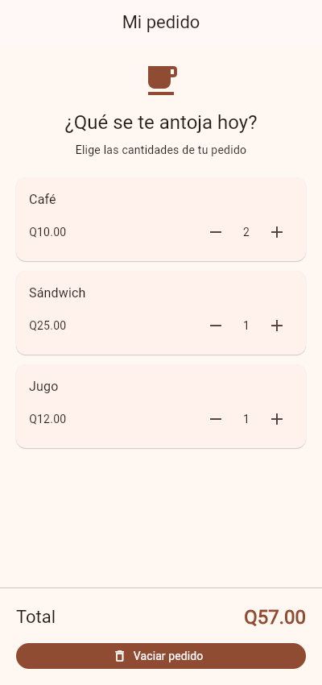

# Mi pedido de cafetería

Laboratorio de Flutter y Dart: pedido con cantidades locales y componentes reutilizables.

## Ejecutar

Desde la carpeta del proyecto, con Flutter instalado:

```sh
flutter pub get
flutter run
```

## Funcionamiento

- Café: Q10.00; Sándwich: Q25.00; Jugo: Q12.00.
- Las cantidades comienzan en cero y se actualizan con `setState`.
- El botón de restar se desactiva en cero. La función que modifica las cantidades
  también rechaza valores negativos.
- **Vaciar pedido** restablece las tres cantidades a cero.

## ¿Cómo se calcula el total?

El getter `_total` recorre los productos y suma el precio unitario multiplicado
por su cantidad. Se calcula desde las cantidades actuales, sin guardar otro estado
que pudiera quedar desactualizado. `toStringAsFixed(2)` muestra dos decimales y
se antepone `Q` para indicar quetzales.

Por ejemplo: 2 × Q10.00 + 1 × Q25.00 + 1 × Q12.00 = **Q57.00**.

## ¿Por qué conviene reutilizar ProductoPedido?

Las tres filas tienen la misma estructura. `ProductoPedido` recibe el nombre,
precio, cantidad y las acciones de sumar y restar como parámetros. Así se evita
duplicar la interfaz y cualquier mejora se aplica a todos los productos.
El estado permanece en la pantalla y el widget solo muestra los datos y comunica
las acciones del usuario.

## Captura

Pedido con dos cafés, un sándwich y un jugo: **Q57.00**.



## Validación

```sh
flutter analyze
flutter test
```

La prueba en `test/widget_test.dart` verifica los cinco casos del enunciado:
inicio en Q0.00, pedido de Q57.00, reducción a Q47.00, protección contra
cantidades negativas y vaciado completo.

## Entrega

Colocar este proyecto completo en `laboratorios/cafeteria` dentro del repositorio
actual del curso, junto con la captura. Desde esa carpeta, ejecutar los comandos
anteriores para comprobarlo antes de subir los cambios.
